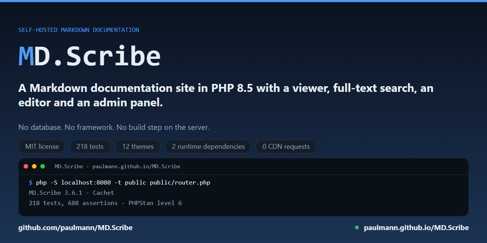

<!--
 * MD.Scribe — Documentation
 * Version: 3.6.1
-->

# MD.Scribe 3

MD.Scribe, PHP 8.5 में लिखा गया एक स्व-होस्टेड Markdown दस्तावेज़ीकरण मंच है: CommonMark/GFM-पूर्ण
व्यूअर, जिसमें पूर्ण-पाठ खोज, कमांड पैलेट, थीम कैटलॉग, Mermaid आरेख और KaTeX गणित हैं, साथ ही
सामग्री प्रबंधक, संपादक, बैकअप, सत्यापित स्व-अपडेटर और ऑडिट ट्रेल वाला प्रशासन पैनल भी। इसे न
डेटाबेस चाहिए, न फ़्रेमवर्क, और न सर्वर पर कोई बिल्ड चरण; हर एसेट स्थानीय रूप से शिप होता है,
इसलिए पूरा एप्लिकेशन ऑफ़लाइन काम करता है।

<!-- md-i18n:switcher -->
**अन्य भाषाओं में:** [English](README.md) · [Deutsch](README.de.md) · [Español](README.es.md) · [Français](README.fr.md) · हिन्दी · [中文](README.zh.md) · [Русский](README.ru.md)

[](https://github.com/paulmann/MD.Scribe/actions/workflows/ci.yml)
[](https://github.com/paulmann/MD.Scribe/releases)
[](LICENSE)
[](https://php.net)
[](tests)
[](#शून्य-cdn-नीति)



[**त्वरित शुरुआत**](#त्वरित-शुरुआत) · [**विशेषताओं का परिचय**](#विशेषताओं-का-परिचय) · [**कॉन्फ़िगरेशन**](#कॉन्फ़िगरेशन--mdini) · [**दस्तावेज़ीकरण**](#दस्तावेज़ीकरण) · [**विकी**](https://github.com/paulmann/MD.Scribe/wiki) · [**AGENTS.md**](AGENTS.md) · [**चेंजलॉग**](CHANGELOG.md) · [**सुरक्षा**](SECURITY.md) · [**योगदान**](CONTRIBUTING.md)

> **दस्तावेज़ीकरण की स्थिति.** इस README का संस्करण और यहाँ दिया गया हर आंकड़ा 2026-11-14 को
> 3.6.0 के `main` ट्री पर मापे गए थे, और जहाँ आंकड़ा आता है वहीं उसका कमांड भी नामित है।
> कार्य-उन्मुख मार्गदर्शिकाएँ [विकी](https://github.com/paulmann/MD.Scribe/wiki/Home) में हैं;
> संदर्भ दस्तावेज़ीकरण [`docs/`](docs/installation.md) में है।

## विषय-सूची

- [MD.Scribe क्या है?](#mdscribe-क्या-है)
- [त्वरित शुरुआत](#त्वरित-शुरुआत)
- [विशेषताओं का परिचय](#विशेषताओं-का-परिचय)
- [कॉन्फ़िगरेशन — `.md.ini`](#कॉन्फ़िगरेशन--mdini)
- [URL अनुबंध](#url-अनुबंध)
- [एम्बेडिंग और CLI रेंडरिंग](#एम्बेडिंग-और-cli-रेंडरिंग)
- [सुरक्षा](#सुरक्षा)
- [संख्याओं में](#संख्याओं-में)
- [विकास](#विकास)
- [दस्तावेज़ीकरण](#दस्तावेज़ीकरण)
- [दस्तावेज़ीकरण की भाषाएँ](#दस्तावेज़ीकरण-की-भाषाएँ)
- [v2 से अपग्रेड करना](#v2-से-अपग्रेड-करना)
- [योगदान](#योगदान)
- [लाइसेंस](#लाइसेंस)
- [परियोजना की मदद करें: प्रमाण, प्रचार नहीं](#परियोजना-की-मदद-करें-प्रमाण-प्रचार-नहीं)

---

## MD.Scribe क्या है?

इसे `.md` फ़ाइलों के किसी फ़ोल्डर पर इंगित करें और आपके पास दस्तावेज़ीकरण साइट तैयार है:

- **`public/index.php`** एक दस्तावेज़ (`?file=path/doc.md`) रेंडर करता है, कोई फ़ाइल न माँगे जाने
  पर खोज-योग्य **लाइब्रेरी**, साथ ही **थीम**, **सेटिंग्स** और **खोज** पेज, `sitemap.xml` और एक
  RSS फ़ीड।
- **`public/admin.php`** प्रशासन पैनल है: डैशबोर्ड, फ़ाइल प्रबंधक, लाइव पूर्वावलोकन वाला
  विभाजित-फलक संपादक, अपलोड, खोज-सूचकांक नियंत्रण, बैकअप और ट्रैश, स्व-अपडेटर, सेटिंग्स
  संपादक, लॉग, ऑडिट ट्रेल, सुरक्षा/स्वास्थ्य जाँच और उपकरण (टूटे-लिंक जाँचक, कैश नियंत्रण)।
- प्रोजेक्ट रूट में **`md.php` / `updater.php`** संगतता शिम हैं — अपग्रेड के बाद भी हर v2 URL
  अनुबंध (`?file=`, `&download=1`, `?update=true`, `?restore=latest`, मशीन API) काम करता रहता है।

**नए हैं?** [विकी](https://github.com/paulmann/MD.Scribe/wiki/Getting-Started)
([होम](https://github.com/paulmann/MD.Scribe/wiki/Home)) से शुरू करें — यह आपको रिलीज़ संग्रह से
चार कमांड में सत्यापित इंस्टॉल तक ले जाती है।

हर चीज़ **स्थानीय Tailwind CSS v4 बिल्ड पर shadcn/ui-टोकन डिज़ाइन सिस्टम** से सजी है, जिसमें
लाइट/डार्क/सिस्टम मोड, 12 चयनित थीम और एक न्यूट्रल × एक्सेंट मिक्सर है। Mermaid, KaTeX, Inter,
JetBrains Mono और सभी आइकन वेंडर किए गए हैं — ऐप पूरी तरह **ऑफ़लाइन / एयर-गैप्ड** काम करता है।

---

## त्वरित शुरुआत

```bash
git clone https://github.com/paulmann/MD.Scribe.git /var/www/docs
cd /var/www/docs

# PHP dependencies are vendored in release archives; from a bare clone:
composer install --no-dev --optimize-autoloader

# put your documents in content/ (or set BROWSE_DIR in .md.ini)
cp ~/my-notes/*.md content/

# develop:
php -S localhost:8080 -t public public/router.php
# → http://localhost:8080        (viewer)
# → http://localhost:8080/admin.php   (admin — first-run setup)
```

प्रोडक्शन परिनियोजन (docroot `public/` पर, docroot प्रोजेक्ट रूट पर, Apache, nginx, Caddy, Docker,
साझा होस्टिंग): **[docs/installation.md](docs/installation.md)**।

आवश्यकताएँ: **PHP ≥ 8.5** के साथ `mbstring`, `dom`, `libxml`, `json` (अपडेटर और बैकअप संग्रह के
लिए `curl` + `phar` + `zip` अनुशंसित)।

---

## विशेषताओं का परिचय

### पढ़ने का अनुभव

| क्षेत्र | विशेषताएँ |
| --- | --- |
| टाइपोग्राफ़ी | तरल टाइप स्केल, टेक्स्ट आकार / पेज चौड़ाई / पंक्ति-ऊँचाई नियंत्रण, सेरिफ़ और सिस्टम फ़ॉन्ट विकल्प, प्रिंट स्टाइलशीट |
| नेविगेशन | स्क्रॉलस्पाई के साथ स्वतः TOC, शीर्षक क्रमांक + हॉवर एंकर, `[TOC]` प्लेसहोल्डर, ब्रेडक्रम्ब, पिछला/अगला पेजर, फ़ोल्डर साइडबार, स्किप लिंक |
| खोज | सर्वर-साइड **पूर्ण-पाठ खोज** (इनवर्टेड इंडेक्स, CJK-सजग) **ऑपरेटरों** के साथ (`tag:`, `path:`, उद्धृत मान), **Ctrl+K कमांड पैलेट** (दस्तावेज़, शीर्षक, क्रियाएँ), **टैग सूचकांक** (`?page=tags`), sitemap.xml, RSS फ़ीड |
| समृद्ध सामग्री | सर्वर-साइड **सिंटैक्स हाइलाइटिंग** (~190 भाषाएँ), स्वतः-मरम्मत + निदान के साथ **Mermaid** आरेख, **KaTeX** गणित (mhchem सहित), GitHub-शैली **अलर्ट**, कार्य सूचियाँ, फ़ुटनोट, परिभाषा सूचियाँ, `==marks==`, ^super^/~sub~स्क्रिप्ट, 1,900+ इमोजी शॉर्टकोड, कैप्शन के साथ छवि **लाइटबॉक्स**, पठन-समय अनुमान |
| ज्ञान आधार | अनुपस्थित-पेज चिह्नों के साथ **विकिलिंक** (`[[Page]]`, `[[Page\|Alias]]`, `[[Page#Heading]]`), **बैकलिंक** ("Linked from"), सार्वजनिक सूचकांक वाले फ्रंटमैटर **टैग**, पुनर्स्थापन के साथ प्रति-दस्तावेज़ **संशोधन इतिहास**, स्व-निहित ZIP में **स्थिर साइट निर्यात** |
| शब्दावली | कोई भी दो-स्तंभ तालिका उपनाम विस्तार (`Term (ABBR)`) के साथ हॉवर/टैप **टूलटिप** बन जाती है, लाइव DOM सामग्री — शून्य दोहराव |
| ऑफ़लाइन | इंस्टॉल-योग्य **PWA**: वेब मैनिफ़ेस्ट + सर्विस वर्कर — एसेट कैश-प्रथम, दस्तावेज़ नेटवर्क-प्रथम और अंतिम पढ़ी प्रति फ़ॉलबैक, JSON API कभी कैश नहीं (`PWA_ENABLED`) |
| थीम | 12 प्रीसेट + न्यूट्रल × एक्सेंट × त्रिज्या × फ़ॉन्ट मिक्सर, लाइट/डार्क/**सिस्टम स्वतः-पहचान**, प्रति-आगंतुक स्थायित्व, प्रशासन-प्रबंधित **कस्टम थीम**, FOUC-मुक्त प्री-पेंट बूटस्ट्रैप |

### Markdown समर्थन

`league/commonmark` के माध्यम से CommonMark **0.31-पूर्ण**, साथ में GFM (संरेखण वाली तालिकाएँ,
स्ट्राइकथ्रू, कार्य सूचियाँ, ऑटोलिंक), फ़ुटनोट (संदर्भ **और** इनलाइन दोनों), परिभाषा सूचियाँ,
गुण-वाक्यविन्यास `{#id .class}`, स्मार्ट विराम-चिह्न (वैकल्पिक), YAML फ्रंटमैटर (`title`,
`description`, `tags`, `author`, `date`, `draft`, `toc`, `numbering`), मृत-लिंक चिह्नों के साथ
सापेक्ष `.md` लिंक का पुनर्लेखन, उपनाम/एंकर रिज़ॉल्यूशन वाले `[[wikilinks]]`, और विरासत में मिले
MD.Viewer अतिरिक्त फ़ीचर (सार्वभौमिक पैटर्न श्रृंखलाएँ, शब्दावली तालिकाएँ, `md.md` नामकरण नियम)।
पूरा मैट्रिक्स: **[docs/markdown-features.md](docs/markdown-features.md)**।

### प्रशासन पैनल

| पेज | यह क्या करता है |
| --- | --- |
| **डैशबोर्ड** | कॉर्पस आँकड़े, सूचकांक ताज़गी, स्वास्थ्य सारांश, त्वरित क्रियाएँ, हाल के दस्तावेज़, गतिविधि फ़ीड |
| **फ़ाइलें** | सारी सामग्री का ट्री, फ़िल्टर, बनाएँ/नाम बदलें/ले जाएँ/हटाएँ (**ट्रैश** में सॉफ़्ट-डिलीट), फ़ोल्डर, बहु-अपलोड (.md + सामग्री-पहचान के साथ छवियाँ), **टेम्पलेट से नया** |
| **संपादक** | विभाजित-फलक लाइव पूर्वावलोकन (*वास्तविक* इंजन), **Markdown टूलबार** (बोल्ड, इटैलिक, कोड, लिंक, विकिलिंक, सूची, अलर्ट, तालिका), **sha256 टकराव पहचान** के साथ ⌘S सहेजें, शब्द/पठन-समय काउंटर, कर्सर पर छवि अपलोड, डीप लिंक `?page=editor&file=…` |
| **खोज सूचकांक** | आँकड़े, ताज़गी, माँग पर पुनर्निर्माण |
| **बैकअप और ट्रैश** | एक-क्लिक सामग्री स्नैपशॉट (+ `.md.ini`), स्वतः पूर्व-पुनर्स्थापन सुरक्षा प्रति के साथ पुनर्स्थापन, zip डाउनलोड, छँटाई-योग्य सूची, हटाई गई फ़ाइल का पुनर्स्थापन |
| **संशोधन** | प्रति-दस्तावेज़ सहेजने का इतिहास (नवीनतम `REVISIONS_MAX`, डिफ़ॉल्ट 20), केवल-पढ़ने योग्य पूर्वावलोकन, ऐसा पुनर्स्थापन जो वर्तमान सामग्री को `(pre-restore)` संशोधन के रूप में रखता है |
| **अपडेट** | GitHub रिलीज़ जाँच (15-मिनट कैश), रिलीज़ नोट्स, **सत्यापित लागू करना** (tarball + प्रति-फ़ाइल sha256 मैनिफ़ेस्ट, बैकअप-प्रथम), मशीन-API दस्तावेज़ |
| **सेटिंग्स** | हर `.md.ini` कुंजी एक टाइप्ड फ़ॉर्म के रूप में (स्कीमा-चालित), API-कुंजी पुनर्जनन, प्रशासन पासवर्ड बदलना |
| **कस्टम थीम** | ब्रांड एक्सेंट सहेजें (लाइट+डार्क प्राइमरी) — सार्वजनिक कैटलॉग में तुरंत चयन-योग्य |
| **लॉग और ऑडिट** | दैनिक ऐप लॉग + JSON ऑडिट ट्रेल (किसने क्या किया, कब, कहाँ से) |
| **सुरक्षा और स्वास्थ्य** | 20+ जाँच: PHP संस्करण/एक्सटेंशन, लिखने-योग्यता, अनुमतियाँ, सीक्रेट स्थिति, OPcache, CSP; हार्डनिंग चेकलिस्ट |
| **उपकरण** | **टूटे-लिंक / मृत-एंकर / अनुपस्थित-मीडिया / अनाथ-दस्तावेज़ जाँचक**, बैकलिंक और टैग सूचकांक का पुनर्निर्माण, **स्थिर साइट निर्यात** (स्व-निहित HTML का ZIP), कैश साफ़ करना, फ़ीड और साइटमैप शॉर्टकट |

### शून्य-CDN नीति

हर एसेट स्थानीय रूप से शिप होता है: Tailwind आउटपुट (विकास के समय बनाया गया, कमिट किया गया),
वेंडर किया गया `mermaid.min.js`, KaTeX (CSS+फ़ॉन्ट+mhchem), Inter और JetBrains Mono के woff2
सबसेट (latin/latin-ext/cyrillic), PHP स्प्राइट मैप में संकलित lucide आइकन, और पूरा gemoji
डेटाबेस। Content-Security-Policy इसे लागू करती है: `default-src 'self'`।

---

## कॉन्फ़िगरेशन — `.md.ini`

पहले लोड पर प्रोजेक्ट रूट के बगल में स्वतः बनाया जाता है। इंस्टॉलेशन-स्तरीय कुंजियाँ हर लोड पर
सुरक्षित डिफ़ॉल्ट के साथ जोड़ी जाती हैं — अपग्रेड में कभी मैनुअल संपादन की ज़रूरत नहीं पड़ती।
रेंडरिंग-विशेषता कुंजियाँ जानबूझकर **नहीं** लिखी जातीं: उनके डिफ़ॉल्ट `config/defaults.php` में
रहते हैं, और आगंतुक उन्हें प्रति-ब्राउज़र बदल सकते हैं (प्रथम-पक्ष कुकीज़)। `.md.ini` में कोई
विशेषता कुंजी जोड़ना उसे **हार्ड-लॉक** कर देता है।

```ini
; General
SITE_NAME = MD.Scribe
HOME_DOC  = index.md
BROWSE_DIR =                     ; empty = bundled content/

; Security & admin
ADMIN_ENABLED = true
ADMIN_USERNAME = admin
ADMIN_PASSWORD =                 ; one-shot: hashed on next load, then cleared
ADMIN_PASSWORD_HASH =            ; managed by the panel — don't edit
ADMIN_RATE_LIMIT = 10            ; failed logins / 15 min / IP
API_KEY = mdv_…                  ; machine API credential (auto-generated)
ALLOW_UPDATE = false
ALLOW_RESTORE = false
ALLOW_RAW_HTML = false           ; escape author HTML (recommended)
ALLOW_IFRAMES = false
ALLOW_EXTERNAL_IMAGES = true
SECURITY_HEADERS = true
SECURITY_CSP = true

; Content
DISABLE_UPLOAD = true
DISABLE_CLIPBOARD = false
DISABLE_SAVE_CLIPBOARD_TO_FILE = true
MAX_UPLOAD_MB = 8

; Performance / feeds / appearance / diagnostics — see docs/configuration.md
```

पूर्ण कुंजी संदर्भ (हर कुंजी, प्रकार, डिफ़ॉल्ट, प्रभाव):
**[docs/configuration.md](docs/configuration.md)**।
प्रति-निर्देशिका `.md.ini` परतें (v2 का `DISABLE_*` तंत्र) संरक्षित हैं:
**[docs/configuration.md#per-directory](docs/configuration.md#per-directory-mdini)**।

---

## URL अनुबंध

| URL | उद्देश्य |
| --- | --- |
| `index.php?file=docs/api.md` | दस्तावेज़ रेंडर करें |
| `index.php?file=docs/api.md&download=1` | स्रोत डाउनलोड (octet-stream + nosniff) |
| `index.php?media=docs/img/pic.png` | सामग्री एसेट (छवियाँ इनलाइन; SVG/zip अनुलग्नक के रूप में) |
| `index.php?page=browser[&dir=docs]` | लाइब्रेरी / फ़ाइल ब्राउज़र |
| `index.php?page=search&q=…` | पूर्ण-पाठ खोज |
| `index.php?page=themes` / `page=settings` | थीम कैटलॉग / सेटिंग्स |
| `index.php?page=sitemap` / `page=feed` | sitemap.xml / RSS |
| `index.php?api=search\|suggest\|toc\|config` | JSON GET एंडपॉइंट |
| `index.php?api=render\|save\|upload` | JSON POST एंडपॉइंट (CSRF) |
| `admin.php?page=…` / `admin.php?action=…` | प्रशासन UI / प्रशासन JSON API |
| `md.php?file=…` | **v2-संगत** व्यूअर शिम |
| `updater.php?update=true` · `?restore=latest` · `?api_key=…&action=…&format=json` | **v2-संगत** अपडेटर + मशीन API |

HTTP कैशिंग: दस्तावेज़ और मीडिया `ETag`/`Last-Modified` के साथ उत्तर देते हैं और
`304 Not Modified` का समर्थन करते हैं; रेंडर किया गया HTML अतिरिक्त रूप से सर्वर-साइड कैश होता
है, स्रोत हैश × सुविधा फ़िंगरप्रिंट की कुंजी पर।

---

## एम्बेडिंग और CLI रेंडरिंग

Markdown पाइपलाइन व्यूअर के बिना भी उपयोगी है: किसी भी PHP कॉलर या शेल स्क्रिप्ट से कोई README,
रिलीज़ नोट या CMS ब्लॉक रेंडर करें, उसी CommonMark/GFM समर्थन, एक्सटेंशन, हाइलाइटिंग और
सैनिटाइज़र के साथ।

```php
require '/path/to/MD.Scribe/src/bootstrap.php';

$renderer = new \MdViewer\Standalone\Renderer();
$result = $renderer->renderFile('/srv/repos/ragraf/README.md');
echo $result->html;                 // embed mode: portable code blocks, no numbering
```

```bash
bin/md-scribe-render README.md --html \
  --base-url="https://ragraf.example.com/" \
  --css="https://example.com/readme.css" > readme.html
```

एम्बेड मोड `<pre><code class="hljs language-…">` और सादे शीर्षक उत्पन्न करता है, ताकि कोई
GitHub-README स्टाइलशीट (`github-markdown-css` + एक highlight.js थीम) पेज को सजा सके। पूर्ण
विकल्प संदर्भ और एकीकरण विधियाँ: **[docs/standalone-renderer.md](docs/standalone-renderer.md)**।

3.2.2 से वही पाइपलाइन अन्य अनुप्रयोगों के लिए एक स्टेटलेस HTTP एंडपॉइंट भी है — Markdown अंदर,
HTML अंश बाहर, कुंजी-प्रमाणित, कोई सत्र नहीं:

```bash
curl -H "X-Api-Key: $API_KEY" -H 'Content-Type: application/json' \
  -d '{"content": "# Title\n\n- one\n- two", "format": "auto"}' \
  https://docs.example.com/index.php?api=render
```

`format` स्वीकार करता है `auto` (डिफ़ॉल्ट), `markdown`, `html` (सैनिटाइज़्ड) और `text`
(`<div class="md-text">` में लिपटा शब्दशः टेक्स्ट)। अनुबंध, सीमाएँ और स्थिति-कोड:
**[docs/http-api.md](docs/http-api.md)**।

---

## सुरक्षा

गहराई में रक्षा — विवरण और हार्डनिंग चेकलिस्ट: **[docs/security.md](docs/security.md)**।

- **पथ सत्यापन**: 14 परतें (लंबाई, NUL, नियंत्रण वर्ण, URL-डिकोड पुनः-जाँच, निरपेक्ष पथ,
  ट्रैवर्सल, सख्त Unicode श्वेतसूची `\p{L}\p{M}\p{Pd}`, गहराई, एक्सटेंशन, realpath सीमाबद्धता,
  सिमलिंक-सुरक्षित पुनः-जाँच) — व्यूअर, डाउनलोड, मीडिया, अपलोड, प्रति-निर्देशिका ini और प्रशासन
  के लिए एक ही सत्यापनक।
- **आउटपुट सैनिटाइज़ेशन**: हर रेंडर किया गया दस्तावेज़ एक DOM-अनुमतिसूची सैनिटाइज़र से गुज़रता है
  (ईवेंट हैंडलर, खतरनाक स्कीम, फ़ॉर्म, foreignObject/`<use>` सब निष्क्रिय); लेखक का कच्चा HTML
  तब तक एस्केप रहता है जब तक `ALLOW_RAW_HTML` चालू न हो — और तब भी सैनिटाइज़ होता है।
- **परिवहन**: प्रति-अनुरोध nonce के साथ सख्त CSP, nosniff, फ़्रेम/रेफ़रर/अनुमति नीतियाँ, COOP;
  कठोर सत्र कुकीज़।
- **प्रशासन**: password_hash लॉगिन, प्रति-IP दर सीमा, हर बदलाव पर CSRF, सत्र पुनर्जनन, ऑडिट ट्रेल,
  सॉफ़्ट डिलीट, प्रथम-रन सेटअप localhost-या-एकबारी-कोड से नियंत्रित।
- **सीक्रेट**: `.md.ini` कभी सर्व नहीं होता (`.htaccess` + docroot-से-बाहर लेआउट); मशीन API
  केवल JSON उत्तर देता है।

किसी भेद्यता की रिपोर्ट: **[SECURITY.md](SECURITY.md)**।

---

## संख्याओं में

2026-11-14 को 3.6.0 के `main` ट्री पर मापा गया:

| सतह | मान | माप स्रोत |
| --- | ---: | --- |
| PHP स्रोत फ़ाइलें | 116 | `Get-ChildItem src,public,templates -Recurse -Filter *.php` |
| परीक्षण फ़ाइलें | 22 | `Get-ChildItem tests -Recurse -Filter *.php` |
| PHPUnit परीक्षण | 214 परीक्षण, 678 अभिकथन, 1 छोड़ा गया | `composer test` |
| दस्तावेज़ीकरण पेज | 12 | `Get-ChildItem docs -Filter *.md` |
| रनटाइम Composer पैकेज | 2 (`league/commonmark`, `scrivo/highlight.php`) | `composer.json` → `require` |
| चयनित थीम | 12 | `config/themes.php` |
| रनटाइम पर CDN अनुरोध | 0 | लागू CSP में `default-src 'self'` |

---

## विकास

```bash
composer install                 # dev deps: phpunit, phpstan
cd tools/frontend && npm install && node build.mjs && cd ../..

composer test                    # 214 PHPUnit tests, 678 assertions
composer stan                    # PHPStan level 6
php -S localhost:8080 -t public public/router.php
```

फ़्रंटएंड पाइपलाइन (Tailwind v4 → `app.css`, esbuild → `app.js`/`admin.js`, थीम कंपाइलर →
`themes.css`, आइकन/इमोजी जनरेटर) केवल **विकास** के समय चलती है — बने हुए एसेट कमिट होते हैं,
इसलिए प्रोडक्शन सर्वरों को Node.js की ज़रूरत नहीं। आर्किटेक्चर, मॉड्यूल मैप, रिलीज़ चेकलिस्ट:
**[docs/development.md](docs/development.md)**।

### परियोजना संरचना

```text
MD.Scribe/
├── public/              ← recommended docroot
│   ├── index.php        front controller (viewer, library, pages, JSON API)
│   ├── admin.php        admin panel + admin JSON API
│   ├── router.php       php -S dev router
│   └── assets/          css/ js/ vendor/{mermaid,katex,fonts} img/  (all local)
├── src/                 PSR-4 app code (MdViewer\)
│   ├── Core/            App, Config, FeatureFlags, Request/Response, Session,
│   │                    Csrf, Logger, AuditLog, HttpClient, Paths, Version
│   ├── Http/            FrontController, AdminKernel, Controllers/
│   ├── Markdown/        engine, sanitizer, glossary, mermaid repair, cache,
│   │                    Extensions/ (math, sub/sup, emoji, alerts, renderers)
│   ├── Files/           PathValidator, repository, search index, uploader,
│   │                    FileManager
│   ├── Admin/           auth, backups, updater, health, link checker
│   ├── Theme/           theme catalog (shadcn token model)
│   └── View/            template engine, generated icon sprite
├── templates/           layout/ viewer/ browser/ pages/ admin/
├── config/              defaults.php (schema) · themes.php · manifest.json
├── content/             ← your documents live here (default BROWSE_DIR)
├── storage/             cache/ backups/ logs/ index/ state/ themes/  (writable)
├── docs/                deep documentation
├── tests/               PHPUnit (Unit + Feature)
├── tools/               build pipeline (frontend/, build-manifest.php)
├── deploy/              nginx, Caddy, Docker, php.ini
├── md.php               v2-compatible viewer shim
├── updater.php          v2-compatible updater + machine API shim
└── index.php            project-root entry (docroot-at-root installs)
```

---

## दस्तावेज़ीकरण

दो परतें: **[विकी](https://github.com/paulmann/MD.Scribe/wiki)** कार्य-उन्मुख मार्गदर्शिका है
(इसे चलाना, कॉन्फ़िगर करना, संचालित करना), जबकि `docs/` की फ़ाइलें वह संदर्भ हैं जिन्हें आप अपने
चलाए जा रहे टैग के विरुद्ध जाँचते हैं।

| दस्तावेज़ | विषय-वस्तु |
| --- | --- |
| **[विकी](https://github.com/paulmann/MD.Scribe/wiki)** | शुरुआत करना, इंस्टॉलेशन, कॉन्फ़िगरेशन, Markdown विशेषताएँ, खोज, प्रशासन मार्गदर्शिका, HTTP API, अपडेट, समस्या-निवारण, विकास, चेंजलॉग — [होम](https://github.com/paulmann/MD.Scribe/wiki/Home) से शुरू करें |
| [docs/installation.md](docs/installation.md) | सभी परिनियोजन लेआउट, Apache/nginx/Caddy/Docker, साझा होस्टिंग, अनुमतियाँ |
| [docs/configuration.md](docs/configuration.md) | पूर्ण `.md.ini` संदर्भ, प्रति-निर्देशिका फ़ाइलें, सुविधा टॉगल |
| [docs/markdown-features.md](docs/markdown-features.md) | उदाहरणों के साथ पूरा सिंटैक्स मैट्रिक्स |
| [docs/admin-guide.md](docs/admin-guide.md) | हर प्रशासन पेज, वर्कफ़्लो, मशीन API |
| [docs/theming.md](docs/theming.md) | थीम सिस्टम, टोकन, कस्टम थीम, विधियाँ |
| [docs/security.md](docs/security.md) | खतरा मॉडल, हार्डनिंग चेकलिस्ट, CSP नोट्स |
| [docs/http-api.md](docs/http-api.md) | JSON एंडपॉइंट (सार्वजनिक + प्रशासन + मशीन API) |
| [docs/standalone-renderer.md](docs/standalone-renderer.md) | Markdown पाइपलाइन एम्बेड करना, CLI और HTTP रेंडर API |
| [docs/development.md](docs/development.md) | आर्किटेक्चर, बिल्ड पाइपलाइन, परीक्षण, रिलीज़ |
| [docs/troubleshooting.md](docs/troubleshooting.md) | सामान्य समस्याएँ और समाधान |
| [docs/upgrade-from-v2.md](docs/upgrade-from-v2.md) | माइग्रेशन मैपिंग और चरण |
| [docs/AGENTS-context.md](docs/AGENTS-context.md) | कोडिंग एजेंट के लिए गहरा प्रोजेक्ट संदर्भ |
| [CONTRIBUTING.md](CONTRIBUTING.md) | बदलाव कैसे प्रस्तावित करें और पहले क्या पास होना चाहिए |
| [SECURITY.md](SECURITY.md) | समर्थित संस्करण और निजी भेद्यता रिपोर्टिंग |
| [CHANGELOG.md](CHANGELOG.md) | हर रिलीज़, Keep a Changelog प्रारूप में |

---

## दस्तावेज़ीकरण की भाषाएँ

अंग्रेज़ी README मानक है। अनूदित README इस फ़ाइल की धारा-दर-धारा प्रतिलिपि है, और जब भी कोई
शीर्षक, कमांड या आंकड़ा बदलता है तो उसी कमिट में अद्यतन किया जाता है। विकी और `docs/` अंग्रेज़ी
में ही रहते हैं।

| भाषा | फ़ाइल | टिप्पणियाँ |
| --- | --- | --- |
| अंग्रेज़ी | [README.md](README.md) | मानक |
| रूसी | [README.ru.md](README.ru.md) | इस फ़ाइल का अनुवाद |
| जर्मन | [README.de.md](README.de.md) | इस फ़ाइल का अनुवाद |
| चीनी (सरलीकृत) | [README.zh.md](README.zh.md) | इस फ़ाइल का अनुवाद |
| हिन्दी | [README.hi.md](README.hi.md) | इस फ़ाइल का अनुवाद |
| स्पेनिश | [README.es.md](README.es.md) | इस फ़ाइल का अनुवाद |
| फ़्रेंच | [README.fr.md](README.fr.md) | इस फ़ाइल का अनुवाद |

जो अनुवाद पीछे रह जाए वह दोष है: भाषा और धारा बताकर उसे रिपोर्ट करें, या ऐसा पुल रिक्वेस्ट
खोलें जो उसे ठीक करे।

---

## v2 से अपग्रेड करना

ड्रॉप-इन: v3 को अपनी v2 फ़ाइलों के बगल में परिनियोजित करें, अपने दस्तावेज़ ले जाएँ (या
`BROWSE_DIR` को उन पर इंगित करें), रूट का `md.php` शिम रखें — हर पुराना बुकमार्क और `?file=`
लिंक काम करता है। चरण-दर-चरण: **[docs/upgrade-from-v2.md](docs/upgrade-from-v2.md)**।

---

## योगदान

प्रति पुल रिक्वेस्ट एक तार्किक बदलाव, नए व्यवहार के लिए एक परीक्षण, और पहले चर्चा के बिना कोई नई
रनटाइम निर्भरता नहीं। गेट हैं `composer test` (214 परीक्षण) और `composer stan` (PHPStan स्तर 6);
दोनों को `0` के साथ बाहर निकलना चाहिए। परंपराएँ, कमिट शैली, दस्तावेज़ीकरण भाषा नीति और
बग-रिपोर्ट चेकलिस्ट: **[CONTRIBUTING.md](CONTRIBUTING.md)**। यह परियोजना
[Contributor Covenant 2.1](CODE_OF_CONDUCT.md) का पालन करती है; किसी प्रश्न या ट्रायाज में सहायता
[SUPPORT.md](SUPPORT.md) में बताई गई है।

## लाइसेंस

MIT — देखें [LICENSE](LICENSE)। व्यावसायिक और निजी उपयोग, संशोधन तथा पुनर्वितरण के लिए मुक्त,
कॉपीराइट सूचना बनाए रखने पर। पुराने संस्करण (3.3.0 तक) PolyForm Noncommercial 1.0.0 के अंतर्गत
जारी होते थे।
Markdown इंजन: [league/commonmark](https://commonmark.thephpleague.com/) (BSD-3)।
हाइलाइटिंग: [scrivo/highlight.php](https://github.com/scrivo/highlight.php) (BSD-3, highlight.js का पोर्ट)।
आरेख: [Mermaid](https://mermaid.js.org/) (MIT)। गणित: [KaTeX](https://katex.org/) (MIT)।
आइकन: [Lucide](https://lucide.dev/) (ISC)। इमोजी डेटा: [gemoji](https://github.com/github/gemoji) (MIT)।
फ़ॉन्ट: Inter और JetBrains Mono (SIL OFL)।

## परियोजना की मदद करें: प्रमाण, प्रचार नहीं

वास्तव में क्या मदद करता है, मूल्य के क्रम में:

- एक **संगतता रिपोर्ट**: PHP संस्करण (`php -v`), वेब सर्वर और उसका संस्करण, परिनियोजन लेआउट
  (docroot `public/`, docroot रूट पर, साझा होस्टिंग), और सटीक कमांड उसके आउटपुट के साथ — प्रत्येक
  अद्वितीय संयोजन के लिए एक रिपोर्ट, मौजूदा इश्यू खोजने के बाद;
- एक **दस्तावेज़ीकरण सुधार** पुल रिक्वेस्ट के रूप में, जिसमें फ़ाइल और पंक्ति का नाम हो;
- एक **सैनिटाइज़्ड केस स्टडी**, जो उसके डेटा स्वामी की अनुमति से प्रकाशित हो;
- किसी फ़ोर्क या रैपर के लिए एक **निर्भरता या सुरक्षा नोट**, उसी स्थान पर प्रकट किया गया।

स्टार, फ़ोर्क, वॉचर, टिप्पणियाँ, इश्यू, पुल रिक्वेस्ट या अनुरक्षक और तृतीय पक्षों को थोक संदेश
कभी स्वचालित न करें। एक एजेंट रिपोर्ट का मसौदा बना सकता है; मानव उसे समीक्षा के बाद प्रकाशित
करता है।
