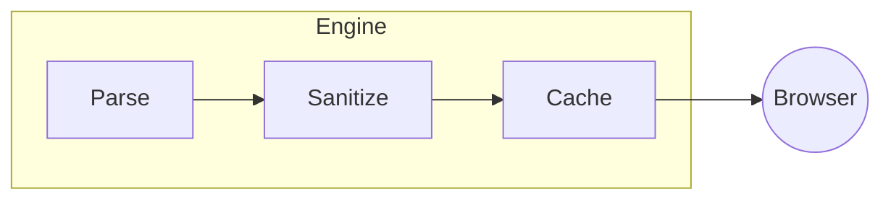

# Markdown reference: everything the engine supports

A complete, testable matrix of the v3 rendering engine
(CommonMark + GFM + extensions). Every block below is live — this page is
its own conformance suite.

## CommonMark core

### Text-level

*emphasis*, **strong**, ***both***, `code span`, ``double ` tick`` spans,
autolinks <https://example.com>, escaped \*asterisks\*, hard line break at
the end of this sentence →

### Block-level

Indented code:

    four spaces = code block

Fenced with tildes:

~~~text
tilde fence
~~~

Setext headings, thematic breaks (---), nested blockquotes:

> outer
>
> > inner quote

## GitHub Flavored Markdown

### Strikethrough & task lists

~~deleted~~, - [x] done, - [ ] todo (see lists above).

### Autolinked URLs

Bare URLs become links: https://github.com/paulmann/MD.Scribe

### Tables with alignment

| Left | Center | Right |
|:-----|:------:|------:|
| a    | b      | c     |
| long content scrolls horizontally on mobile | ✓ | ✓ |

## Extensions

### Footnotes

Reference[^ref] and inline^[Inline footnote bodies live at the reference.]
forms both work.

[^ref]: The collected definition, with a backlink ↩.

### Definition lists

Apple
: A fruit. Also a company.

PHP
: A server-side language. This viewer runs on 8.3.

### Attributes (PHP-Markdown style)

{#custom-id .custom-class}

A paragraph can carry `{#id .class key=value}` attributes.

### Highlight, sub/sup

==Marked text==, chemical H~2~O, mathematical x^2^, 2^10^ = 1024.

### Smart punctuation (opt-in)

Enable `FEATURE_SMART_PUNCT` to get "curly quotes", en-dashes -- and
ellipses... automatically.

### Emoji

:heart: :fire: :100: :tada: :thinking: :white_check_mark: — full gemoji set.

### Math (KaTeX, local)

Inline $\alpha + \beta = \gamma$ and display:

$$
\begin{pmatrix} a & b \\ c & d \end{pmatrix}
\begin{pmatrix} x \\ y \end{pmatrix} =
\begin{pmatrix} ax + by \\ cx + dy \end{pmatrix}
$$

### Mermaid (local, auto-repaired)



### Details/disclosure (raw HTML, when enabled)

With `ALLOW_RAW_HTML = true`:

<details>
<summary>Click to expand</summary>

Content inside a disclosure widget — full Markdown works here too.

</details>

## Images & media

Relative images resolve against the document and stream through the media
route (works even when the content root is not the web root):


Images get lazy-loading, a lightbox on click, and a caption when a title is
given. External images follow `ALLOW_EXTERNAL_IMAGES`.

## Document controls (frontmatter)

```yaml
---
title: Overrides the first H1
description: Meta description
tags: [a, b]
author: Name
date: 2026-01-31
draft: true      # hide from browser/search/feeds
toc: false       # hide the TOC sidebar
numbering: false # disable heading numbers
---
```

## In-document TOC

Writing `[TOC]` on its own line inserts a table of contents right there
(the sidebar TOC is separate and always available on wide screens).

[TOC]

---

[← Security model](../security.md) · [Back to top](#)
