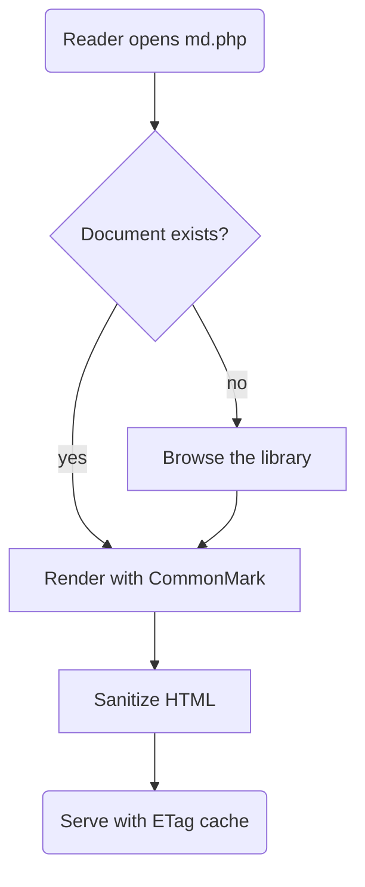
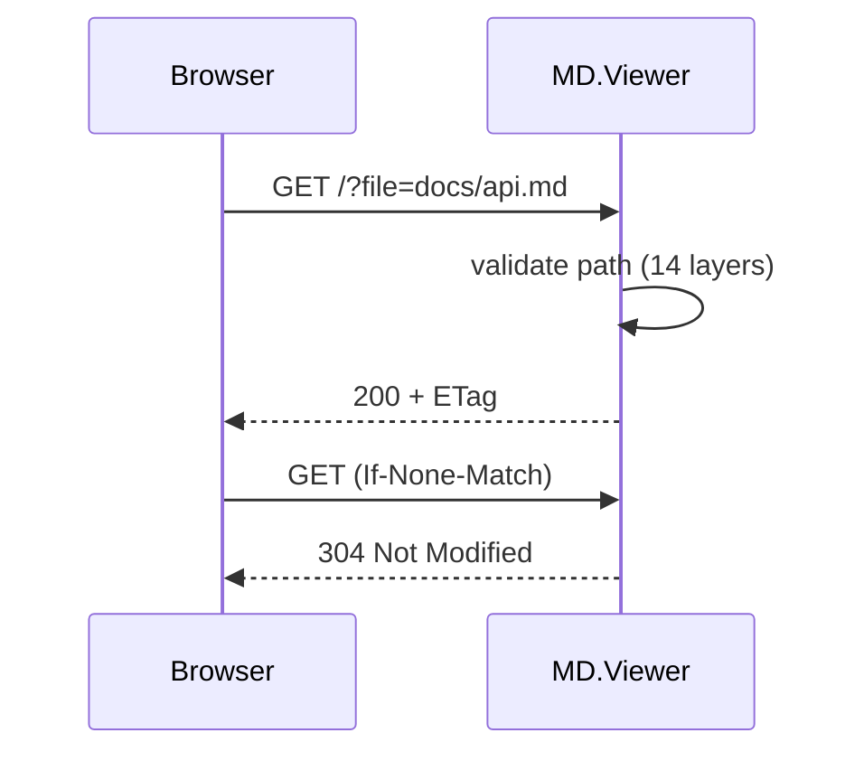

# MD.Viewer: Self-hosted docs, distilled

Welcome! This document is a **live feature tour** — every element below is
rendered by the built-in Markdown engine and styled by the local design
system. Nothing is loaded from a CDN: fonts, icons, Mermaid, KaTeX and all
JavaScript ship with the app.

> [!TIP]
> Press **Ctrl+K** (⌘K on macOS) anywhere to open the command palette —
> jump to documents, headings and actions without touching the mouse.

## Why MD.Viewer

- **Zero dependencies at runtime** — plain PHP 8.3, no database, no build step on the server.
- **Full Markdown** — CommonMark + GitHub Flavored Markdown, footnotes, definition lists, math, diagrams, alerts and more.
- **Secure by default** — every document passes a DOM-allowlist sanitizer; CSP, hardened sessions and path-traversal-proof validation.
- **A real admin panel** — content manager, uploads, backups, updater, settings editor, logs, health checks and an audit trail.
- **Themeable** — 12 curated themes, a neutral × accent mixer, light/dark/system with auto-detection. See the [Theme catalog](?page=themes).

## Formatting basics

**Bold**, *italic*, ***both***, ~~strikethrough~~, ==highlight==, `inline code`,
H~2~O and E=mc^2^, plus emoji: :rocket: :tada: :books: — 1,900+ shortcodes.

Links: [internal document](getting-started.md), [external site](https://github.com/paulmann/MD.Viewer),
[heading anchor](#tables), and missing links render with a ⚠ marker so dead
links never hide: [a broken link](definitely-missing.md).

### Blockquotes & alerts

> “Simplicity is the ultimate sophistication.”
> — attributed to Leonardo da Vinci

> [!NOTE]
> GitHub-style alerts come in five flavors.

> [!WARNING]
> They render as accessible callouts with icons.

### Lists

1. Ordered lists
2. With nesting
   1. like this
   2. and this
- Unordered lists
- [x] Task lists (done)
- [ ] Task lists (open)

Term
: Definition lists render as styled term/definition pairs.

Second term
: With their own definitions, PHP-Markdown style.

## Tables

| Feature        | v2 (legacy)   | v3 (this build)      |
| -------------- | :-----------: | -------------------- |
| Engine         | hand-rolled   | CommonMark + GFM     |
| Styling        | Tailwind CDN  | local Tailwind build |
| Diagrams       | CDN mermaid   | local mermaid        |
| Math           | —             | KaTeX (local)        |
| Search         | filter rows   | full-text index      |
| Admin          | updater.php   | full admin panel     |

Alignment works: left by default, center and right with colons.

| Language | Typing     | Speed |
| -------- | :--------: | ----: |
| PHP      | dynamic    | fast  |
| Rust     | static     | fastest |
| JS       | dynamic    | jit   |

## Code

Syntax highlighting runs **server-side** (no client JS), with copy and
word-wrap controls:

```php title="src/Http/FrontController.php"
<?php
declare(strict_types=1);

final class FrontController
{
    public function handle(): Response
    {
        return match (true) {
            $this->req->query('file') !== null => $this->viewer->show(),
            default => $this->browser->show(),
        };
    }
}
```

```js
// JavaScript works too
const themes = await fetch('/?api=config').then(r => r.json());
console.log(themes.config.themeDefault);
```

```bash
composer install && php -S localhost:8080 -t public public/router.php
```

Pattern chains from MD.Viewer v2 still render visually:
`(Client) --> [HTTP/1.1] --> (Server)`

## Diagrams

Mermaid renders locally, with the server-side auto-repair engine (PlantUML
notes, literal `\n`, unquoted parentheses — all fixed before the browser
ever sees them):





## Math

Inline math like $e^{i\pi} + 1 = 0$ flows with the text, while display math
gets its own centered block:

$$
\int\limits_{-\infty}^{\infty} e^{-x^2}\,dx = \sqrt{\pi}
\qquad
\nabla \times \mathbf{B} = \mu_0\mathbf{J} + \mu_0\varepsilon_0 \frac{\partial \mathbf{E}}{\partial t}
$$

Chemistry works too via mhchem: $\ce{H2SO4 + 2NaOH -> Na2SO4 + 2H2O}$

## Footnotes

Footnotes get proper references[^1] and backlinks[^2].

[^1]: Rendered by the CommonMark footnote extension with accessible roles.
[^2]: The definitions collect at the bottom of the document.

## Glossary tooltips

Any table whose first column has a header doubles as a glossary — terms get
dotted underlines and hover tooltips, with alias expansion:

| Term | Definition |
| ---- | ---------- |
| CSP (Content Security Policy) | A header that tells the browser which resources a page may load. MD.Viewer ships a strict CSP with per-request nonces. |
| ETag | An HTTP validator; MD.Viewer answers 304 when a document has not changed. |
| GFM | GitHub Flavored Markdown — tables, strikethrough, task lists, autolinks. |

Try hovering (or tapping) “CSP”, “ETag” or “GFM” in this paragraph. The
tooltip content is read live from the table above — no duplication.

## Frontmatter

This very page uses YAML frontmatter for `title`, `description` and `tags`.
Also supported per document: `draft: true` (hides from browser and search),
`toc: false`, `numbering: false`, `author`, `date`.

## Raw HTML

Author HTML is escaped by default (`<script>alert(1)</script>` above stays
text). Enable `ALLOW_RAW_HTML` in `.md.ini` to keep sanitized author markup —
the allowlist sanitizer still strips event handlers and dangerous URLs.

---

Ready? Continue with **[Getting started →](getting-started.md)**, open the
**Library** to browse everything, or make it yours in the **Theme catalog**.
